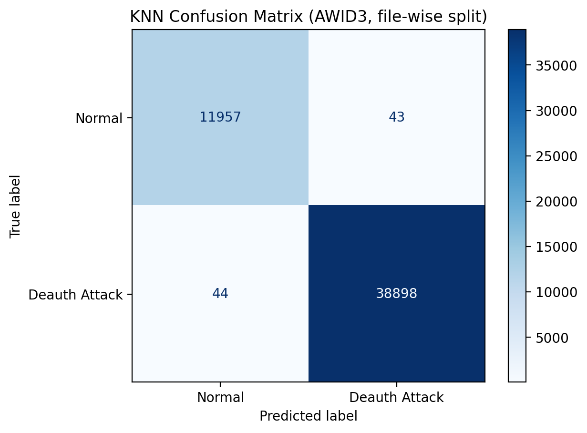

# WIDS: Deauthentication Attack Detector

A simple machine-learning Wireless Intrusion Detection System (WIDS) that labels Wi-Fi frames as **Normal** or **Deauth Attack** and raises an alert when it spots an attack.

It only detects and alerts. It does not block anything.

## How it works

1. Reads AWID3 deauthentication CSV files from the `deauth/` folder.
2. Picks a few simple features: frame length, signal strength, timing, data rate, frame flags and frames per second sent by each device.
3. Trains a **KNN classifier (k = 5)** from scikit-learn on scaled features.
4. Tests it on capture files it has never seen (4-fold, file-wise split) and reports accuracy and a confusion matrix.
5. Replays 20 test frames like live traffic, printing `[OK]` or `[ALERT]` and saving alerts to `wids_alerts.log`.

## Dataset

AWID3 (deauth captures), from Kaggle: `suumia/awid3-dataset`.
The data is not in this repo because it is too large. Download it and put the CSV files in a folder called `deauth/` next to the script.

## Run it

```bash
pip install -r requirements.txt
python pritpal_wids.py
```

## Output

- `confusion_matrix.png`: the confusion matrix
- `wids_alerts.log`: timestamped alerts from the replay

## Results

12 of the 33 AWID3 deauth files were usable (12,000 normal and 38,942 deauth frames), tested with 4 rounds of file-wise cross-validation.

- Accuracy: **99.83% ± 0.09%**
- False positive rate: **0.36% ± 0.16%** (43 of 12,000 normal frames)
- Missed attacks: 44 of 38,942 (about 0.11%)

| | Predicted Normal | Predicted Deauth |
|---|---|---|
| **Actual Normal** | 11,957 | 43 |
| **Actual Deauth** | 44 | 38,898 |



Note: the test sets are about 75% attack because of how normal frames were sampled, so this is not a real-world traffic mix.

## Limitations

- The demo replays dataset frames, it is not a live capture.
- All files come from the same captures, so the network and devices are shared between training and testing.
- The sender MAC in an alert can be forged, since attackers can copy the access point's address.
- Only deauthentication attacks are detected.
- No automatic blocking (WIDS only, not WIPS).

## Future improvements

- Test on a capture from a different network
- Live capture with Scapy or monitor mode
- Alert on time windows instead of single frames
- Detect other attacks (Evil Twin, jamming, probe floods)
- Add WIPS mitigation that does not rely on MAC alone, such as rate limiting

## Use of AI

I used Claude to help structure the pipeline, suggest the file-wise evaluation, and restructure the code. I chose the AWID3 data and feature set, ran and debugged the code in VS Code, and wrote comments based on my understanding. I can explain each step, including why subtype and the protected flag are excluded and why the split is by file.


## Author

Pritpal Kaur, Computer Networks and Cybersecurity Student, Strathmore University
